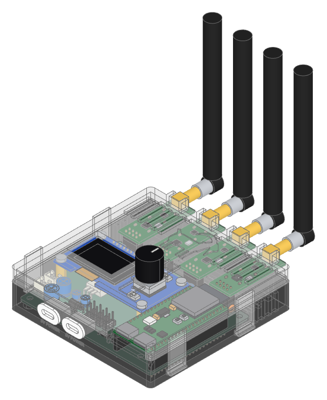
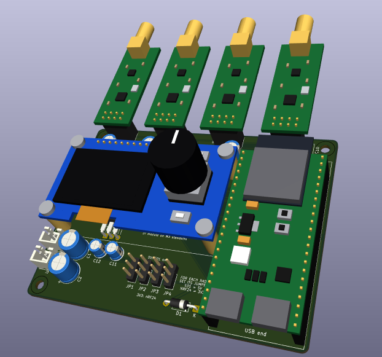
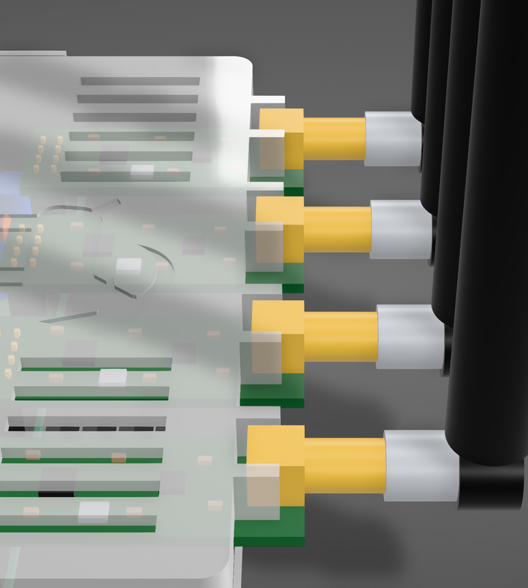
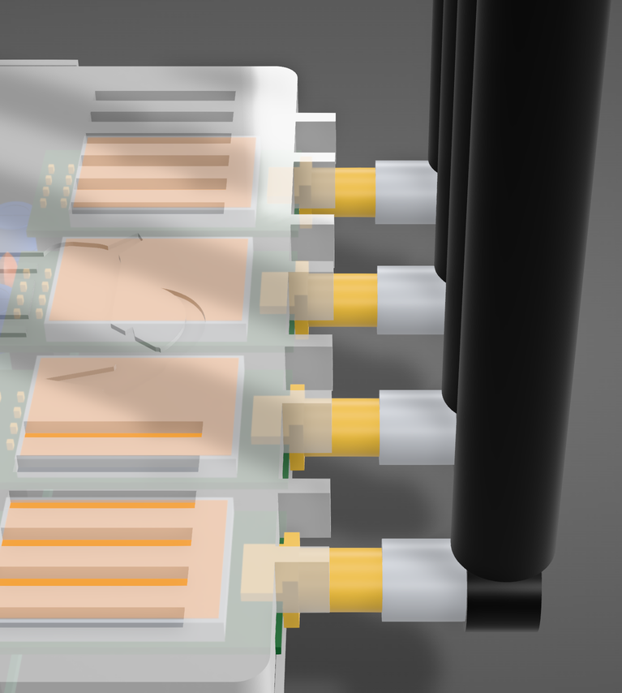

# Bluetooth Radio Manager

A self-contained, battery-powered box that puts **four 2.4 GHz radios** under one **ESP32-S3**, with a small OLED and encoder UI, in a 3D-printed case. Each radio slot takes an nRF24L01+PA+LNA or an Ebyte E01-2G4M27D, and the firmware decides what the four radios do: range tests, multi-channel sniffing, relays, mesh experiments, or anything else that needs several 2.4 GHz radios in one hand-held unit.

<p align="center">
  
</p>

Everything is open: the KiCad board, the parametric case, the fab files and the firmware skeleton are in this repository.

## Contents

1. [Overview](#1-overview)
2. [PCB and components](#2-pcb-and-components)
3. [Ordering the PCB](#3-ordering-the-pcb)
4. [Ordering the case](#4-ordering-the-case)
5. [Firmware skeleton](#5-firmware-skeleton)

---

## 1. Overview

| | |
|---|---|
| **Radios** | 4 slots, 2×4 socket each, nRF24L01+PA+LNA or E01-2G4M27D, SMA antennas out the back |
| **Controller** | YD-ESP32-23 (ESP32-S3 DevKitC-1 clone, 16 MB flash, 8 MB PSRAM), socketed |
| **UI** | 1.3" I²C OLED, EC11 encoder with push, BACK and CONFIRM buttons, on a plug-in module |
| **Power** | Two 5 V USB-C sockets in the case, one or two power banks, 3.5 to 10 h of continuous transmit |
| **Board** | 96.5 × 73.2 mm, 2 layers, all through-hole and socketed, hand-solderable |
| **Case** | Two-part 3D print, snap latches, vented, 103 × 103 × 26 mm, 41 mm to the top of the knob, antennas extra. One case fits either radio |
| **Firmware** | PlatformIO, Arduino framework, native and on-device tests |

The carrier board does only three things: power the radios correctly, wire them to one SPI bus with separate select and interrupt lines, and hold the modules so they can be swapped without tools. Everything else is firmware.

---

## 2. PCB and components

<p align="center">
  
</p>

### Bill of materials

| Ref | Part | Role |
|-----|------|------|
| M1–M4 | 2×4 female header, 2.54 mm | Radio slots, along the top edge so the modules and antennas hang off the board |
| U1 | YD-ESP32-23 on 2 × 1×22 female headers | Controller, drives all four radios over one SPI bus |
| J1 | UI module on 1×9 female header + 4 × M3 standoffs | OLED, encoder, BACK and CONFIRM buttons |
| U2 | LD1117V33, TO-220, mounted flat | Shared 3.3 V rail for nRF24 slots, 800 mA |
| D1 | 1N5819 Schottky, DO-41 | Feeds the devkit from input A and stops its USB power reaching the radios |
| JP1–JP4 | 1×3 pin header + shunt | Radio slot supply select, 5 V or 3.3 V |
| C3–C6 | 220 µF / 10 V electrolytic | Bulk capacitor per radio slot, for TX bursts |
| C7–C10 | 100 nF ceramic | Decoupling per radio slot |
| C1, C2 | 470 µF / 10 V electrolytic | Bulk capacitor on each 5 V input |
| C11, C12 | 10 µF / 16 V electrolytic | LD1117 input and output |
| J2, J3 | JST-XH 2-pin | 5 V inputs A and B, pigtails from the case's USB-C sockets |
| MH1–MH4 | M3 holes | Case mounting |

### Radio modules and jumpers

Both modules share the nRF24L01 2×4 pinout (GND, VCC, CE, CSN, SCK, MOSI, MISO, IRQ), so either fits any slot. Each slot has a jumper selecting its supply. Fit **one** shunt per slot, or none to leave the slot unpowered.

| | nRF24L01+PA+LNA | E01-2G4M27D |
|---|---|---|
| Max TX power | 20 dBm (100 mW) | 27 dBm (500 mW) |
| VCC | 1.9–3.6 V | 2.5–5.5 V |
| TX current | ~115 mA @ 3.3 V | 390 mA @ 5 V |
| **Jumper** | **3V3** (pins 2-3) | **5V** (pins 1-2) |

> **Warning:** a shunt on `5V` with an nRF24L01+PA+LNA fitted destroys the module. Check the jumpers before applying power. The silkscreen next to the jumpers repeats this.

Mechanically the two differ: the nRF24 is 41 × 15.5 mm with its SMA jack standing on the board, the E01 is 33.2 × 18 mm with a 3.7 mm shield can and an edge-mount SMA at the board end. Both are modelled, and the board exists in two files that differ only in which module the sockets show: `bt_radio_manager.kicad_pcb` with nRF24s (the one to order from) and `bt_radio_manager_e01.kicad_pcb` with E01s, for checking the fit and seeing the finished product with each radio.

### Pin map

| Function | GPIO | | Function | GPIO |
|----------|------|-|----------|------|
| SPI SCK / MOSI / MISO | IO12 / IO11 / IO2 | | I²C SDA / SCL | IO14 / IO13 |
| Radio 1 CE / CSN / IRQ | IO7 / IO1 / IO15 | | Encoder A / B / push | IO5 / IO4 / IO6 |
| Radio 2 CE / CSN / IRQ | IO9 / IO8 / IO16 | | CONFIRM button | IO21 |
| Radio 3 CE / CSN / IRQ | IO17 / IO10 / IO18 | | BACK button | IO38 |
| Radio 4 CE / CSN / IRQ | IO40 / IO39 / IO41 | | | |

### Power

Input A feeds the ESP32 (through D1) and radio slots 1–2; input B feeds slots 3–4 and the 3.3 V regulator. Splitting the load keeps each power-bank port under about 1 A and keeps the ESP32's supply separate from the regulator feeding the nRF24s. The devkit's own 3.3 V regulator supplies the UI module.

D1 matters when programming without a power bank: the devkit passes its USB VBUS out through its 5 V pin, so without the diode a PC port would also be powering any E01 jumpered to 5 V on slots 1–2. With it the PC feeds only the devkit.

| All four radios transmitting | Draw at 5 V | 10,000 mAh power bank |
|---|---|---|
| 4 × E01-2G4M27D | ~1.7 A (8.6 W) | ~3.5–4 h |
| 4 × nRF24L01+PA+LNA | ~0.6 A (3.1 W) | ~10 h |

### Design notes

- **A jumper per slot instead of a regulator per slot.** The E01 runs straight from 5 V and keeps 3.3 V logic; only the nRF24 needs 3.3 V, and one LDO covers all four at nRF24 currents. This removed four buck modules from an earlier revision.
- **A linear regulator, not a buck.** PA/LNA radios amplify supply noise. The LD1117 has no switching ripple and dissipates at most 0.8 W, fine for a TO-220 without a heatsink.
- **Decoupling at every slot**, 220 µF + 100 nF next to each socket for 490 mA TX bursts, 470 µF on each input for cable and power-bank response.
- **Space under the modules.** The devkit and UI module sit 11 mm above the board. U2 lies flat under the OLED, and a mounting hole sits under the devkit's USB end where plug insertion pushes hardest.
- **Routing.** GND pour on both layers. Power nets 0.6 mm, signals 0.2 mm, 14 vias. The SPI bus is shared, each radio has its own CE, CSN and IRQ.

### Design files

| Path | Contents |
|------|----------|
| `hardware/kicad/bt_radio_manager.kicad_sch` / `.kicad_pcb` | KiCad 10 schematic and layout |
| `hardware/kicad/bt_radio_manager_e01.kicad_pcb` | The same layout with the E01-2G4M27D in the radio sockets, for 3D viewing and the case check |
| `hardware/kicad/bt_tester_parts.pretty/` | Custom footprints: radio socket (one each showing the nRF24 and the E01), YD-ESP32-23, UI module |
| `hardware/kicad/bt_tester_parts.3dshapes/` | STEP models (nRF24L01+PA+LNA, E01-2G4M27D, antenna, devkit, UI module) and the Python scripts that generate them |
| `docs/E01-2G4M27D_Usermanual_EN_v1.3.pdf` | E01 manual, source of its pinout and dimensions |

---

## 3. Ordering the PCB

Upload **`hardware/kicad/bt_radio_manager_gerbers.zip`**. It holds the nine Gerber layers, the PTH and NPTH Excellon drill files and the job file, as exported by KiCad 10. Any board house that takes Gerbers works.

| Parameter | Value |
|-----------|-------|
| Layers | 2 |
| Size | 96.5 × 73.2 mm |
| Material / thickness | FR-4, 1.6 mm |
| Copper | 1 oz (35 µm) outer |
| Surface finish | HASL lead-free is enough; ENIG if offered at no cost |
| Solder mask | any colour, both sides |
| Silkscreen | both sides, white. The back carries the logo and the version mark |
| Min track / clearance | 0.2 mm / 0.2 mm |
| Min hole | 0.3 mm (vias), plated. Largest 1.1 mm. Two NPTH sizes for the mounting holes |
| Via | 0.6 mm pad, 0.3 mm drill |
| Castellations, impedance control, stencil, assembly | none needed, everything is through-hole and hand-soldered |
| Quantity | 5 is the usual minimum |

The defaults on JLCPCB, PCBWay or Aisler all satisfy this. Order the parts in the bill of materials alongside; the modules, devkit and UI module parts come from the usual module sellers, the rest from any distributor.

---

## 4. Ordering the case

Upload the two files in **`case/print/`**. Both are 1:1 in millimetres. Order one of each.

| File | Part | Size (mm) |
|------|------|-----------|
| `enclosure_base.stl` or `.step` | Base: tray, board standoffs, USB-C openings labelled "5V POWER", latch pockets, floor vents | 103.3 × 103.4 × 19.7 |
| `enclosure_lid.stl` or `.step` | Lid: flat deck with OLED window, encoder hole, flush flexure buttons, engraved logo, latch tabs, SMA guides | 108.3 × 108.4 × 23.2 |

The lid snaps onto the base with four flexible tabs that hook into pockets in the side walls, so the material has to tolerate about 1 mm of flex each time it's opened. The lid's extra 5 mm of length is the SMA guide ribs on the back wall.

| Process and material | Verdict |
|---|---|
| **MJF or SLS nylon, PA12** | Best. Tough, isotropic, no supports. Usually the default "nylon" option |
| **FDM, PETG** | Good and cheapest. See the settings below |
| FDM, PLA | Works, but goes brittle with age; the tabs may crack after a year |
| SLA / resin | Avoid, the latches will snap |

**Parameters to request:** PA12 nylon (or PETG on FDM), any colour, standard tolerance (±0.2 mm or ±0.3 %), no smoothing. Walls are 2.4 mm, floor 2.0, deck 1.6, latch tabs 1.4, all above the usual 1 mm minimum. Density is not applicable to nylon; 20 to 30 % infill on FDM.

**FDM settings:** 0.2 mm layers with a 0.4 mm nozzle, base floor-down and lid upside down (deck on the bed; its top is one flat plane), no supports on either part, **4 perimeters** so the latch tabs and walls are solid. Put the seam on the narrow 1.4 mm edges of the four latch tabs, not their flat faces, and not on "random".

**Hardware to buy with it:** 4 × M3 heat-set inserts (3 mm long, 4.2 mm OD) and 4 × M3 × 6 screws for the board, and 2 × USB-C panel-mount power sockets with 2-wire pigtails (13 × 5.11 mm snap-in body, 15.7 × 9 mm oval flange) for the front wall.

The case is generated by `case/enclosure.py` with [build123d](https://build123d.readthedocs.io/), reading part positions from the KiCad board, so it follows the layout. Running it rewrites `case/print/`, checks the case against every part on both board variants, and shows the assembly in the VS Code OCP CAD Viewer. Every dimension is a parameter at the top of the script.

The same case takes either radio in any slot. The back wall sits just in front of the E01's SMA flange, so the longer nRF24's jack stands about 1 mm further out; the wall notches and support blocks are 18 mm wide for the E01 and the blocks are pocketed for its edge-mount SMA legs, and the deck clears the E01's shield can. Outside the wall, a pair of ribs on the lid straddles the square section of each SMA jack, which is the same width on both modules, so a module cannot swing sideways in its notch. Because of these ribs, take the lid off straight up by releasing the latches on both sides, rather than tilting it open on one side.

<p align="center">
  
  
</p>
<p align="center"><em>Left: nRF24L01+PA+LNA. Right: E01-2G4M27D. Same case, lid translucent to show the modules through the back wall and the guide ribs either side of each SMA jack.</em></p>

**Viewing and regenerating the case.** You need KiCad 10 (the script calls `kicad-cli` from its default install path, set at the top of the script), Python 3 with `build123d` and `ocp_vscode`, and the *OCP CAD Viewer* extension in VS Code.

```bash
pip install build123d ocp_vscode
```

Open the OCP CAD Viewer panel in VS Code (Ctrl+K V), then run from the repository root:

```bash
python case/enclosure.py          # board with four nRF24L01+PA+LNA
python case/enclosure.py e01      # board with four E01-2G4M27D
```

Each run exports the chosen board from KiCad to STEP, builds the case, prints the clearance check for both board variants and the part sizes, rewrites `case/print/` and `case/out/`, and sends the board, base, lid and USB sockets to the viewer. `case/out/assembly_<radio>.step` holds the complete product with that radio fitted, for any other CAD program. Without the viewer open the script still runs and only reports that it could not reach it. Set `LID_LIFT` in the script to show the lid raised above the base.

---

## 5. Firmware skeleton

PlatformIO project, Arduino framework, two environments: `yd_esp32_23` for the board and `native` for logic tests on the computer.

```
├── platformio.ini                  # board, partitions, ports, test settings
├── src/main.cpp                    # application entry point
├── test/test_basic/                # logic tests, run native and on device
├── test/test_rgb_led/              # hardware smoke test, device only
├── partitions/partitions_16MB_psram.csv
└── AGENTS.md                       # rules for AI coding agents working here
```

**Setup.** Install PlatformIO (VS Code extension or `pip install platformio`). Plug the devkit's **UART** USB-C connector, not the one marked USB: it is a CH343P bridge that stays on the bus through resets, which the test runner needs. Find the port and put it in `platformio.ini`:

```ini
upload_port = COM3        ; or /dev/cu.usbmodem…, /dev/ttyUSB0
test_port   = COM3
```

**Commands:**

```bash
pio run                      # build
pio run --target upload      # flash
pio device monitor           # serial at 115200
pio test -e native           # logic tests, no board
pio test -e yd_esp32_23      # tests on the board
```

**What's there and what comes next.** `main.cpp` is a placeholder that flashes the devkit's onboard RGB LED, and the tests show the pattern for native and on-device Unity tests (see `how_to_unit_test.md`). The radio application builds on the pin map in section 2:

- one `SPIClass` on IO12 / IO11 / IO2, shared by all four radios;
- four radio drivers, one per slot, each with its own CE, CSN and IRQ pin, for example the RF24 library with `RF24(ce, csn)` per slot;
- the UI on I²C (IO14 / IO13) with an SSD1306 or SH1106 driver, the encoder on IO5 / IO4 with push on IO6, buttons on IO21 and IO38;
- whatever the four radios should do, as a state machine driven from `loop()`.

The custom partition table is required: the default one lacks the `otadata` partition at `0xe000` and the `coredump` partition, and without them the board fails to boot after flashing. `AGENTS.md` records that and the other board constraints for anyone, human or agent, changing the firmware.
