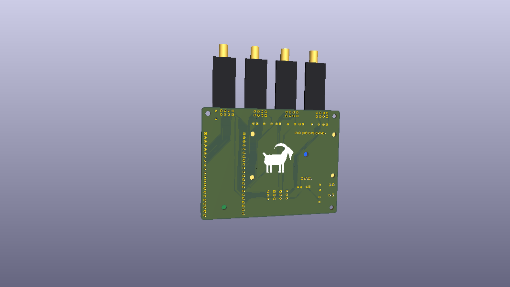

# Bluetooth Radio Manager — PlatformIO

Bluetooth module for the **YD-ESP32-23** board. Based on [esp32-hello-world](https://github.com/marianobilli/esp32-hello-world).

- **Board:** YD-ESP32-23 (ESP32-S3 DevKitC-1 clone)
- **Flash:** 16 MB
- **PSRAM:** 8 MB (OPI)
- **Framework:** Arduino via PlatformIO

<p align="center">
  
</p>

---

## Hardware

A carrier PCB that holds **four 2.4 GHz radios**, an **ESP32-S3 devkit**, and an **OLED + rotary encoder UI module**, powered from one or two 5 V USB power banks. Every part is socketed or through-hole, so the board can be hand-soldered and the modules swapped without tools.

<p align="center">
  
</p>

| | |
|---|---|
| **Board** | 96.5 × 73.2 mm, 2 layers, GND pour on both sides, 4 × M3 mounting holes |
| **Radios** | 4 slots, each takes an nRF24L01+PA+LNA **or** an Ebyte E01-2G4M27D (same 2×4 pinout) |
| **MCU** | YD-ESP32-23 (ESP32-S3 DevKitC-1 clone) on 2 × 22-pin sockets |
| **UI** | 1.3" OLED + EC11 encoder + BACK/CONFIRM buttons module, on a 1×9 socket and M3 standoffs |
| **Power** | Two 5 V inputs (JST-XH), per-slot 5 V / 3.3 V radio supply select |
| **Design files** | KiCad 10 project in [`hardware/kicad`](hardware/kicad) |

### Components

| Ref | Part | Role |
|-----|------|------|
| M1–M4 | 2×4 female header, 2.54 mm | Radio slots. The module bodies and antennas hang off the top edge of the board |
| U1 | YD-ESP32-23 on 2 × 1×22 female headers | Controller, drives all four radios over one SPI bus |
| J1 | UI module on 1×9 female header + 4 × M3 standoffs | 1.3" I²C OLED, EC11 encoder with push, BACK and CONFIRM buttons |
| U2 | LD1117V33, TO-220, mounted flat (tab down) | Shared 3.3 V rail (`+3V3_RF`) for nRF24 slots, 800 mA |
| D1 | 1N5819 Schottky, DO-41 | Feeds the devkit's 5 V pin from input A; blocks the devkit's USB power from back-feeding the radios |
| JP1–JP4 | 1×3 pin header + jumper shunt | Selects each radio slot's supply: 5 V or 3.3 V |
| C3–C6 | 220 µF / 10 V electrolytic | Bulk capacitor per radio slot, for TX current bursts |
| C7–C10 | 100 nF ceramic | High-frequency decoupling per radio slot |
| C1, C2 | 470 µF / 10 V electrolytic | Bulk capacitor on each 5 V input |
| C11, C12 | 10 µF / 16 V electrolytic | LD1117 input / output capacitors |
| J2, J3 | JST-XH 2-pin | 5 V inputs **A** and **B** (USB-C power bank leads) |
| MH1–MH4 | M3 holes | Case mounting |

### Radio modules

Both modules share the standard nRF24L01 2×4 pinout (1 GND, 2 VCC, 3 CE, 4 CSN, 5 SCK, 6 MOSI, 7 MISO, 8 IRQ), so either fits any slot.

| | nRF24L01+PA+LNA | Ebyte E01-2G4M27D |
|---|---|---|
| Size (without SMA) | 41 × 15.5 mm | 33.4 × 18 mm |
| Max TX power | ~20 dBm (100 mW) | 27 dBm (500 mW) |
| VCC range | 1.9–3.6 V | 2.5–5.5 V |
| TX current | ~115 mA @ 3.3 V (typical) | 390 mA @ 5 V, 490 mA @ 3.3 V |
| Slot jumper | **3V3** | **5V** |

### Radio supply jumpers

Each slot has its own 3-pin jumper (JP*n* powers M*n*). Fit **one** shunt per slot:

| Shunt | Slot VCC | Use with |
|-------|----------|----------|
| top (1-2), `5V` | 5 V straight from the power input | E01-2G4M27D **only** |
| bottom (2-3), `3V3` | 3.3 V from U2 | nRF24L01+PA+LNA |
| none | unpowered | safe default |

> **Warning:** a shunt on `5V` with an nRF24L01+PA+LNA in the slot destroys the module (VCC max 3.6 V). Check the jumpers before plugging in power.

### ESP32-S3 pin map

| Function | GPIO | | Function | GPIO |
|----------|------|-|----------|------|
| SPI SCK | IO12 | | I²C SDA | IO14 |
| SPI MOSI | IO11 | | I²C SCL | IO13 |
| SPI MISO | IO2 | | Encoder A | IO5 |
| Radio 1 CE / CSN / IRQ | IO7 / IO1 / IO15 | | Encoder B | IO4 |
| Radio 2 CE / CSN / IRQ | IO9 / IO8 / IO16 | | Encoder push | IO6 |
| Radio 3 CE / CSN / IRQ | IO17 / IO10 / IO18 | | CONFIRM button | IO21 |
| Radio 4 CE / CSN / IRQ | IO40 / IO39 / IO41 | | BACK button | IO38 |

The ESP32 devkit is powered from input A through its own 5 V pin, via Schottky diode D1 (anode on `+5V_A`, cathode on the devkit). Its onboard 3.3 V regulator also supplies the UI module (`+3V3_SYS`).

D1 is there for programming without a power bank. The devkit passes its USB VBUS out through its 5 V pin, so without D1 a PC's USB port would also be powering any E01 radio jumpered to `5V` on slots 1–2. With D1 the USB port feeds only the devkit, and in battery mode the devkit simply sees about 4.7 V instead of 5 V, which is fine for its onboard regulator. The radios still get the full 5 V, since D1 is only in the devkit branch.

### Power budget

| Load (all radios transmitting continuously) | Input A | Input B |
|---------------------------------------------|---------|---------|
| 4 × E01-2G4M27D on 5 V | ~0.93 A (2 radios + ESP32) | ~0.78 A (2 radios) |
| 4 × nRF24L01+PA+LNA on 3.3 V | ~0.15 A (ESP32 only) | ~0.47 A (all 4 radios via U2) |

Estimated runtime from a 10,000 mAh power bank, assuming about 31.5 Wh usable at 5 V after the bank's own conversion losses, with all four radios transmitting non-stop:

| Setup | Total draw at 5 V | Runtime |
|-------|-------------------|---------|
| 4 × E01-2G4M27D | ~1.7 A (8.6 W) | **~3.5–4 h** |
| 4 × nRF24L01+PA+LNA | ~0.6 A (3.1 W) | **~10 h** |

Runtime scales with transmit duty cycle, so bursty tests last proportionally longer.

### Design decisions

**Radios hang off the board edge.** The sockets sit along the top edge and are rotated so each module body and its SMA antenna point away from the board; the enclosure supports them. This keeps the PCB small, keeps the antennas clear of the ground pour and the ESP32, and makes swapping modules easy. The 22.2 mm slot pitch leaves room for the wider (18 mm) E01 in every slot.

**A supply jumper per slot instead of a regulator per slot.** An earlier revision had one buck converter per radio. The E01-2G4M27D, though, accepts 2.5–5.5 V and keeps 3.3 V logic, so it runs straight from the 5 V input, drawing even less current at 5 V than at 3.3 V. Only the nRF24 needs 3.3 V, and at about 115 mA per module one shared linear regulator handles all four. Removing the four buck modules saved about 64 × 35 mm of board. With no shunt fitted a slot stays unpowered, so a freshly built board can't damage a radio.

**A linear regulator, not a buck, for 3.3 V.** The PA/LNA radios amplify whatever noise sits on their supply. An LDO has no switching ripple, needs only two capacitors, and at nRF24 currents dissipates at most about 0.8 W, within what a TO-220 handles without a heatsink. The LD1117V33 (800 mA) leaves headroom for all four slots.

**Using the space under the modules.** The ESP32 devkit and the UI module both sit 11 mm above the board (8.5 mm socket + 2.5 mm header spacer), and that space is used:
- U2 is bent 90° and lies flat under the OLED half of the UI module, about 4.5 mm tall instead of 19 mm standing.
- A mounting hole sits under the devkit near its USB end, where plug insertion pushes hardest. Fit that screw before plugging in the devkit.
- Both footprints' courtyards cover only their sockets, standoffs and the encoder legs; the full module outlines are drawn on the silkscreen.

**Two 5 V inputs.** Input A powers the ESP32 and radio slots 1–2; input B powers slots 3–4 and the 3.3 V regulator. This splits the worst-case E01 load (about 1.7 A) across two power-bank ports, each under about 1 A, and keeps the ESP32's supply separate from the regulator feeding the nRF24s.

**Decoupling at every slot.** The 220 µF + 100 nF capacitors sit right next to each socket, to absorb TX current bursts (up to 490 mA on an E01). A 470 µF capacitor on each input covers cable and power-bank response time.

**Routing.** Two layers, with GND poured on both and also routed as tracks. Power nets (`+5V_*`, `+3V3_*`, `VRF_*`, GND) use 0.6 mm tracks, signals 0.25 mm. The SPI bus is shared by all four radios, each with its own CE, CSN and IRQ lines.

**All through-hole and socketed.** Every part can be hand-soldered, and the ESP32, UI module and radios plug in, so a damaged module is a swap, not a rework.

<p align="center">
  
</p>

### Hardware files

| Path | Contents |
|------|----------|
| `hardware/kicad/bt_radio_manager.kicad_sch` | Schematic |
| `hardware/kicad/bt_radio_manager.kicad_pcb` | PCB layout |
| `hardware/kicad/bt_tester_parts.pretty/` | Custom footprints: radio socket, YD-ESP32-23, UI module |
| `hardware/kicad/bt_tester_parts.3dshapes/` | STEP models plus the Python scripts that generate them (`make_*.py`, `step_writer.py`) |

### Enclosure

A two-part 3D-printed case, generated by `case/enclosure.py` with [build123d](https://build123d.readthedocs.io/). Part positions are read from the KiCad board file, so moving a footprint moves its cutout.

- **Base** with M3 heat-set standoffs at the four mounting holes, a lip for lid alignment, two openings in the front wall for snap-in USB-C power sockets (2-wire pigtails to J2 / J3), and a bay for the devkit's own USB-C ports.
- **Lid** with the OLED window, encoder cutout, two flexure buttons over BACK and CONFIRM, a raised strip over the taller devkit, and the goat in relief.
- **Snap latches** instead of screws: four flexible tabs on the lid hook into pockets in the base side walls. Pull one side's tabs out with a fingernail and lift.
- **Vents**: intake slots in the floor and side walls under the radios, exhaust slots in the lid deck beside the logo. Four E01 modules in continuous transmit leave about 6.5 W inside the case.
- The radio modules pass through notches in the back wall, so the SMA jacks and antennas are outside.

```bash
python case/enclosure.py      # exports case/out/enclosure_{base,lid}.{step,stl,3mf}
```

The script also runs a clearance check of the case against every part on the board, and shows the assembly in the VS Code OCP CAD Viewer if it is open. Print the lid deck-down and the base floor-down; PETG is the better choice for the latch tabs. All dimensions, including the USB socket cutouts, vent slots and latch geometry, are parameters at the top of the script.

---

> New to PlatformIO? Start here. This guide walks you through setup, the physical board, and how to build and run your first test.

---

## Table of Contents

1. [Prerequisites](#1-prerequisites)
2. [Install PlatformIO](#2-install-platformio)
3. [Physical setup — which USB port to use](#3-physical-setup--which-usb-port-to-use)
4. [Find your serial port and configure platformio.ini](#4-find-your-serial-port-and-configure-platformioini)
5. [Build and upload](#5-build-and-upload)
6. [Running tests](#6-running-tests)
7. [Project structure](#7-project-structure)
8. [AI coding agent setup](#8-ai-coding-agent-setup)

---

## 1. Prerequisites

- A computer running macOS, Linux, or Windows
- Python 3.8 or newer (required by PlatformIO)
- A USB-C cable (data-capable, not charge-only)
- The YD-ESP32-23 board

---

## 2. Install PlatformIO

PlatformIO can be used as a VS Code extension or as a standalone CLI tool. Both are supported.

**VS Code extension (recommended for beginners):**

1. Install [Visual Studio Code](https://code.visualstudio.com/)
2. Open the Extensions panel and search for **PlatformIO IDE**
3. Install it — the `pio` CLI becomes available automatically in the integrated terminal

**CLI only:**

```bash
pip install platformio
```

Verify the installation:

```bash
pio --version
```

---

## 3. Physical setup — which USB port to use

The YD-ESP32-23 has **two USB-C connectors** on the board. Using the wrong one is the most common source of confusion.

```
┌─────────────────────────────────────┐
│          YD-ESP32-23                │
│                                     │
│  [UART] ← use this one              │
│  [USB]  ← do NOT use for flashing   │
│                                     │
└─────────────────────────────────────┘
```

| Connector label | Chip behind it | When to use |
|-----------------|----------------|-------------|
| `UART`          | CH343P (dedicated USB-to-UART bridge) | **Always** — for upload, tests, and serial monitor |
| `USB`           | ESP32-S3 built-in USB peripheral | Not needed for this workflow |

**Always plug into the `UART` connector.**

The `UART` connector uses a CH343P chip — a separate, dedicated bridge that stays alive regardless of what the ESP32-S3 is doing (including resets and flashing). This is critical for test runs: after the board is flashed it resets, and if the serial port disappears during that reset `pio test` will hang waiting for output that never arrives. The CH343P port does not disappear.

The `USB` connector exposes the ESP32-S3's built-in USB peripheral directly. It drops off the bus during resets, which breaks the test runner.

---

## 4. Find your serial port and configure platformio.ini

PlatformIO needs to know which serial port your board is connected to. You must set this once for your machine.

### On macOS / Linux

List ports before and after plugging in the board to identify the new one:

```bash
# Before plugging in
ls /dev/cu.*

# Plug in the UART connector, then run again
ls /dev/cu.*
```

The new entry is your board's port. It will look something like:

```
/dev/cu.usbmodem5ABA0887541   # macOS (CH343P)
/dev/ttyUSB0                  # Linux (CH343P)
```

### On Windows

Open **Device Manager**, expand **Ports (COM & LPT)**, and look for the new COM port that appears when you plug in the board (e.g. `COM3`).

### Update platformio.ini

Open `platformio.ini` and replace the port values in the `[env:yd_esp32_23]` section:

```ini
upload_port = /dev/cu.usbmodem5ABA0887541   ; <- replace with your port
test_port   = /dev/cu.usbmodem5ABA0887541   ; <- same port, replace here too
```

On Windows it would be:

```ini
upload_port = COM3
test_port   = COM3
```

> Both `upload_port` and `test_port` should point to the same port — the CH343P `UART` connector.

---

## 5. Build and upload

Build the project (compiles without uploading):

```bash
pio run
```

Build and flash to the board:

```bash
pio run --target upload
```

Open the serial monitor to see output:

```bash
pio device monitor
```

Press `Ctrl+C` to exit the monitor.

---

## 6. Running tests

Tests live in `test/`. PlatformIO supports two environments:

| Environment | Runs on | Board required |
|-------------|---------|----------------|
| `native`    | Your computer | No |
| `yd_esp32_23` | The physical board | Yes, connected via `UART` |

```bash
# Run logic tests on your computer (no board needed)
pio test -e native

# Run hardware tests on the board (board must be connected)
pio test -e yd_esp32_23
```

See [how_to_unit_test.md](how_to_unit_test.md) for a full guide on writing and running tests.

---

## 7. Project structure

```
.
├── platformio.ini                      # Board, framework, and environment config
├── AGENTS.md                           # AI coding agent guidelines (see below)
├── src/
│   └── main.cpp                        # Application entry point
├── test/
│   ├── test_basic/                     # Logic tests — run native and on device
│   └── test_rgb_led/                   # RGB LED smoke tests — device only
├── partitions/
│   └── partitions_16MB_psram.csv       # Custom partition table for 16 MB flash
├── hardware/
│   └── kicad/                          # KiCad 10 schematic, PCB, footprints and 3D models
├── case/
│   └── enclosure.py                    # Parametric 3D-printed enclosure (build123d)
└── images/                             # Renders used in this README
```

---

## 8. AI coding agent setup

This project is developed with **[OpenCode](https://opencode.ai)**, an AI coding assistant that automatically loads `AGENTS.md` as a system-level instruction file for the agent working in this repo.

`AGENTS.md` contains board-specific rules, build constraints, partition table requirements, USB serial flags, and testing conventions that the agent must follow. It is the single source of truth for how code should be written and validated in this project.

**Using Claude Code instead?** Rename `AGENTS.md` to `CLAUDE.md`. Claude Code reads `CLAUDE.md` from the project root and loads it as agent context automatically. The content is identical — only the filename needs to change.

| Tool | Instruction file |
|------|-----------------|
| OpenCode | `AGENTS.md` |
| Claude Code | `CLAUDE.md` |

### Key configuration notes

**Custom partition table** (`partitions/partitions_16MB_psram.csv`): required because the default partition table does not include an `otadata` partition at `0xe000`. Without it, `esptool` corrupts the boot process and the board panics before `setup()` ever runs. It also includes a `coredump` partition required by the ESP32-S3 crash handler.

**USB serial build flags** (in `platformio.ini`):

```ini
board_build.extra_flags =
    -DARDUINO_USB_MODE=1
    -DARDUINO_USB_CDC_ON_BOOT=1
```

These flags redirect Arduino's `Serial` object to the USB CDC interface so that serial output is visible from boot. Without them, `Serial.print()` goes to UART0 — a hardware UART pin that nothing is connected to — and `pio test` hangs forever waiting for output.

> Side effect: `Serial.flush()` becomes blocking when no serial monitor is open. Do not leave firmware running `Serial.flush()` without a connected monitor.
